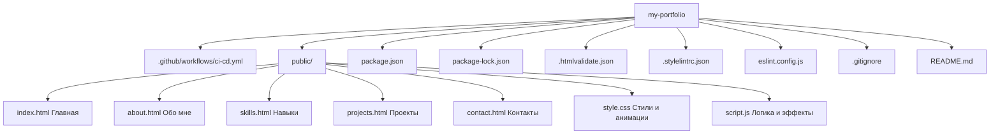
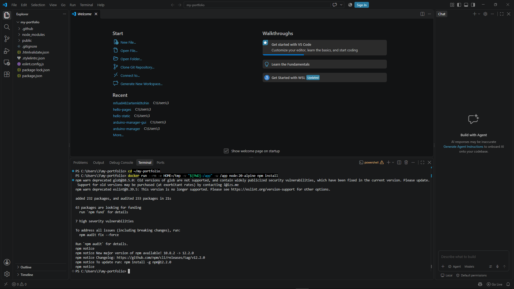
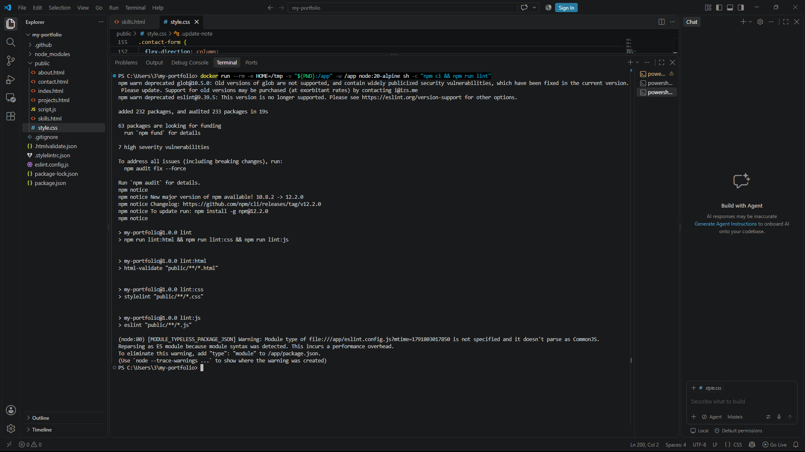
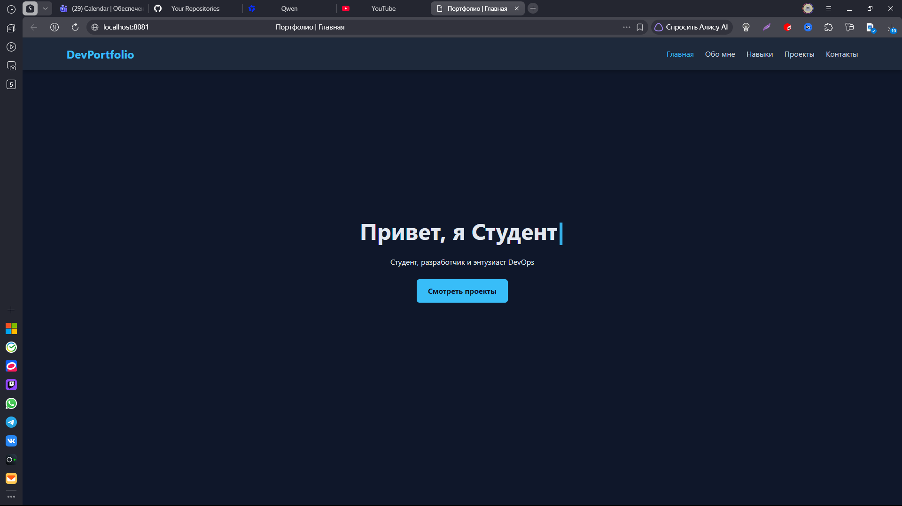
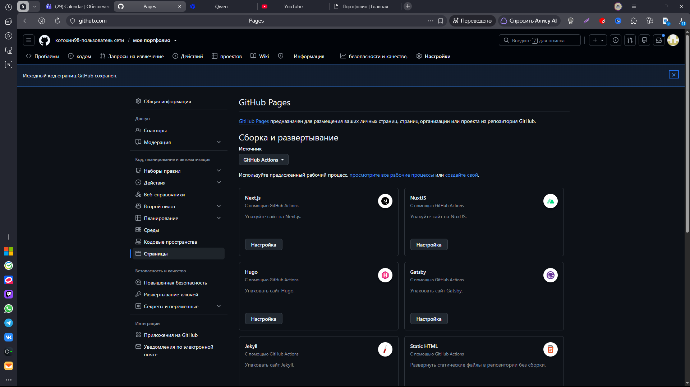
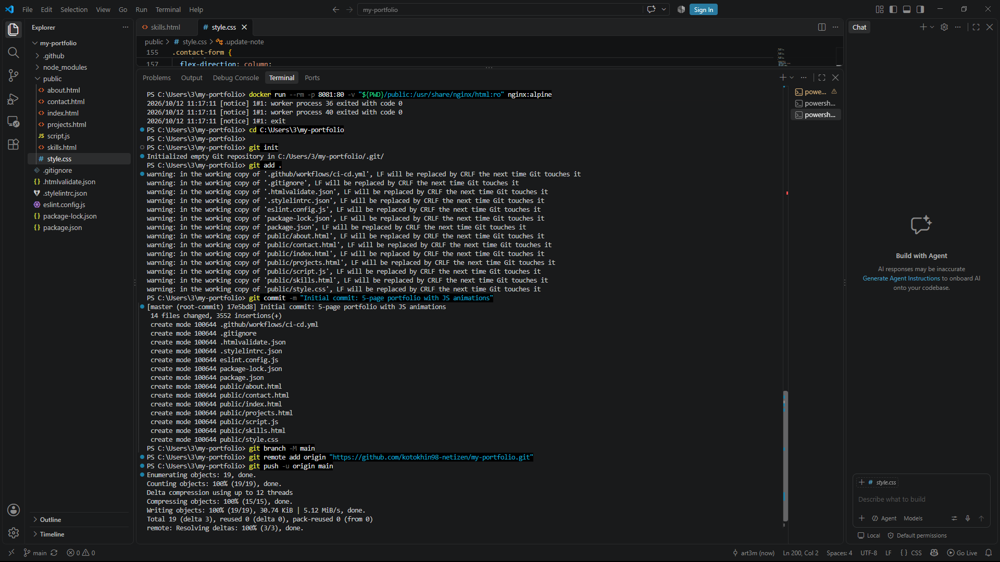
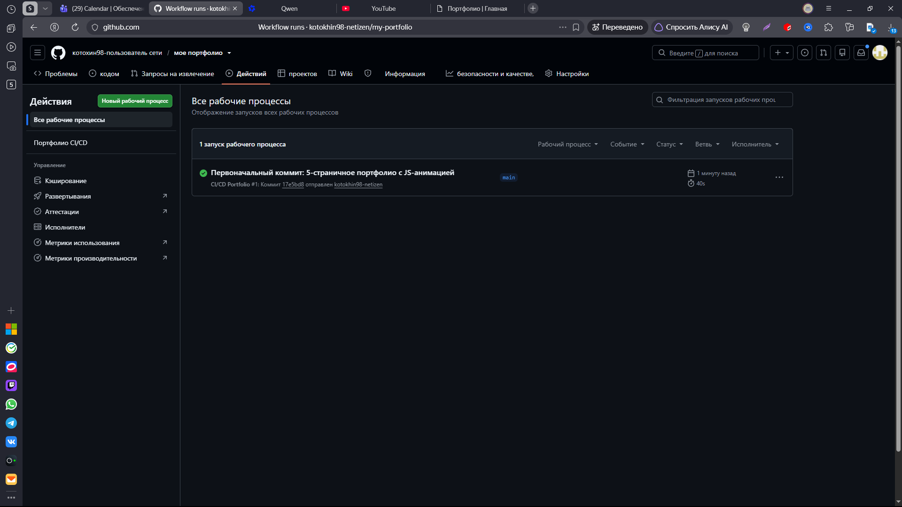
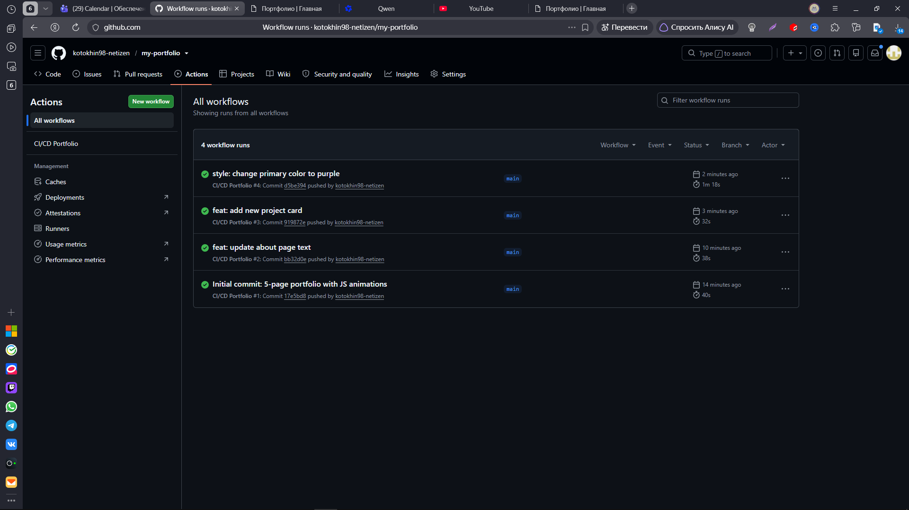

#  My Portfolio — Статический сайт с CI/CD на GitHub Pages

[](https://github.com/kotokhin98-netizen/my-portfolio/actions/workflows/ci-cd.yml)
[](https://kotokhin98-netizen.github.io/my-portfolio/)
[](https://html-validate.org/)
[](https://stylelint.io/)
[](https://eslint.org/)
[](LICENSE)

Стильный многостраничный сайт-портфолио на **HTML5 + CSS3 + Vanilla JavaScript** с анимациями и автоматическим деплоем на **GitHub Pages** через **GitHub Actions CI/CD**.

🔗 **Живой сайт:** https://kotokhin98-netizen.github.io/my-portfolio/

---

##  Содержание

- [О проекте](#о-проекте)
- [Технологии](#технологии)
- [Структура проекта](#структура-проекта)
- [Локальный запуск](#локальный-запуск)
- [CI/CD Pipeline](#cicd-pipeline)
- [Скриншоты](#скриншоты)
- [Что освоено](#что-освоено)
- [История обновлений](#история-обновлений)
- [Частые проблемы](#частые-проблемы)

---

## 🎯 О проекте

Этот проект демонстрирует **настоящий Continuous Deployment** для статического многостраничного сайта:

- ✅ **5 страниц** — Главная, Обо мне, Навыки, Проекты, Контакты
- ✅ **JS-анимации** — эффект печатающегося текста, плавное появление элементов
- ✅ **CSS-анимации** — hover-эффекты, прогресс-бары, fade-in при загрузке
- ✅ **Автоматическая валидация** — `html-validate`, `stylelint`, `eslint`
- ✅ **Гейтинг деплоя** — `deploy` не запустится, если `ci` упал
- ✅ **Передача артефакта** — папка `public/` передаётся между job'ами
- ✅ **Относительные пути** — работают на GitHub Pages без настройки `base`
- ✅ **CDN** — GitHub Pages автоматически раздаёт статику по всему миру

---

## 🛠 Технологии

| Категория | Инструмент | Назначение |
|-----------|-----------|:----------:|
| **Разметка** | HTML5 | Структура 5 страниц |
| **Стили** | CSS3 (Grid, Flexbox, Animations) | Дизайн и анимации |
| **Скрипты** | Vanilla JavaScript (ES2022) | Интерактивность |
| **Хостинг** | GitHub Pages | Бесплатный деплой с HTTPS |
| **CI/CD** | GitHub Actions | Автоматическая проверка и деплой |
| **Линтеры** | `html-validate`, `stylelint`, `eslint` | Валидация кода |
| **Контейнеризация** | Docker (Node 20 Alpine, Nginx Alpine) | Локальное тестирование |

---

##  Структура проекта



> 💡 Папка `public/` деплоится на GitHub Pages **как есть** — без сборки. Относительные пути (`./style.css`, `./script.js`) работают автоматически.

---

## 🖥 Локальный запуск

### Требования
- [Docker Desktop](https://www.docker.com/products/docker-desktop/) (должен быть запущен)
- Git Bash или PowerShell

### 1. Установка зависимостей

```powershell
cd my-portfolio
docker run --rm -e HOME=/tmp `
  -v "${PWD}:/app" `
  -w /app `
  node:20-alpine `
  npm install
```

### 2. Валидация кода (линтеры)

```powershell
docker run --rm -e HOME=/tmp `
  -v "${PWD}:/app" `
  -w /app `
  node:20-alpine `
  sh -c "npm ci && npm run lint"
```

**Ожидаемый вывод:**
```
> my-portfolio@1.0.0 lint:html
> html-validate "public/**/*.html"

> my-portfolio@1.0.0 lint:css
> stylelint "public/**/*.css"

> my-portfolio@1.0.0 lint:js
> eslint "public/**/*.js"
```

### 3. Просмотр сайта через Nginx

```powershell
docker run --rm -p 8081:80 `
  -v "${PWD}/public:/usr/share/nginx/html:ro" `
  nginx:alpine
```

Откройте: **http://localhost:8081/**

Проверьте:
- 🎯 Анимацию печатающегося текста на главной странице
- 🎨 Плавное появление карточек при загрузке
- 📊 Анимированные прогресс-бары на странице "Навыки"
- 📄 Переходы между 5 страницами через навигацию

> ⚠️ После проверки нажмите `Ctrl + C` в терминале.

---

## 🔄 CI/CD Pipeline

### Workflow: `ci-cd.yml`

```yaml
name: CI/CD Portfolio

on:
  push:
    branches: [ main ]

permissions:
  contents: read
  pages: write
  id-token: write

concurrency:
  group: "pages"
  cancel-in-progress: false

jobs:
  # ===== Job 1: CI — валидация статики =====
  ci:
    runs-on: ubuntu-latest
    steps:
      - uses: actions/checkout@v4
      - name: Setup Node.js
        uses: actions/setup-node@v4
        with:
          node-version: '20'
          cache: npm
      - name: Install dependencies
        run: npm ci
      - name: Lint HTML
        run: npm run lint:html
      - name: Lint CSS
        run: npm run lint:css
      - name: Lint JS
        run: npm run lint:js
      - name: Upload artifact
        uses: actions/upload-artifact@v4
        with:
          name: public
          path: public
          retention-days: 1

  # ===== Job 2: Deploy — только после успешного CI =====
  deploy:
    needs: ci
    if: github.ref == 'refs/heads/main'
    runs-on: ubuntu-latest
    environment:
      name: github-pages
      url: ${{ steps.deployment.outputs.page_url }}
    steps:
      - name: Download artifact
        uses: actions/download-artifact@v4
        with:
          name: public
          path: public
      - name: Setup Pages
        uses: actions/configure-pages@v5
      - name: Upload artifact to Pages
        uses: actions/upload-pages-artifact@v3
        with:
          path: ./public
      - name: Deploy to GitHub Pages
        id: deployment
        uses: actions/deploy-pages@v4
```

### Как это работает

```
┌─────────────────────────────────────────────────────────┐
│  Push в main                                            │
────────────────────┬────────────────────────────────────┘
                     ▼
┌─────────────────────────────────────────────────────────┐
│  Job: ci                                                │
│  • npm ci                                               │
│  • lint:html (html-validate)                            │
│  • lint:css  (stylelint)                                │
│  • lint:js   (eslint)                                   │
│  • upload-artifact (папка public/)                      │
└────────────────────┬────────────────────────────────────
                     │ needs: ci
                     ▼
─────────────────────────────────────────────────────────┐
│  Job: deploy (только если ci ✅)                         │
│  • download-artifact (public/)                          │
│  • configure-pages                                      │
│  • upload-pages-artifact (path: ./public)               │
│  • deploy-pages → GitHub Pages CDN                      │
└─────────────────────────────────────────────────────────┘
```

### Continuous Deployment vs Continuous Delivery

| Тип | Описание | Этот проект |
|-----|----------|:-----------:|
| **CI** | Автоматическая проверка кода | ✅ `job: ci` |
| **CDel** | Готовит релиз, деплой вручную | ❌ |
| **CDep** | Автодеплой после CI | ✅ `job: deploy` |

> 💡 **Ключевая особенность:** `needs: ci` — деплой **не запустится**, если валидация упала. Это и есть настоящий Continuous Deployment.

---

##  Скриншоты

### Локальная валидация линтерами


### Локальный просмотр сайта


### Настройка GitHub Pages


### Успешный CI/CD (4 запуска)


### Environment: github-pages


### Deployments (история обновлений)


### Живой сайт (после 3-го обновления)


---

## 🎓 Что освоено

- **HTML5** — семантическая разметка многостраничного сайта
- **CSS3** — Flexbox, Grid, CSS Animations, hover-эффекты
- **Vanilla JavaScript** — эффект печатающегося текста, анимация прогресс-баров
- **GitHub Pages** — бесплатный хостинг с HTTPS и CDN
- **GitHub Actions** — единый workflow с двумя job'ами (`ci` + `deploy`)
- **`needs: ci`** — гейтинг деплоя (настоящий CD)
- **`actions/upload-artifact` / `download-artifact`** — передача `public/` между job'ами
- **Относительные пути** — `./style.css` работает на Pages без `base`
- **`environment: github-pages`** — привязка к окружению с историей
- **`permissions: pages: write`** — права для деплоя
- **`concurrency: pages`** — защита от параллельных деплоев
- **Environments & Deployments** — история развёртываний
- **Docker** — локальная проверка через контейнеры Node и Nginx
- **Линтеры** — `html-validate`, `stylelint`, `eslint` для валидации статики

---

## 📝 История обновлений

В рамках лабораторной работы было выполнено **4 деплоя**:

| # | Коммит | Изменения | Статус |
|---|--------|-----------|:------:|
| 1 | `Initial commit: 5-page portfolio with JS animations` | Создание сайта с 5 страницами, анимациями, CI/CD | ✅ |
| 2 | `feat: update about page text` | Изменение текста на странице "Обо мне" | ✅ |
| 3 | `feat: add new project card` | Добавление новой карточки проекта | ✅ |
| 4 | `style: change primary color to purple` | Изменение основного цвета (синий → фиолетовый) | ✅ |

> 💡 Каждый деплой запускался **автоматически** после push в `main`, благодаря `needs: ci` и `if: github.ref == 'refs/heads/main'`.

---

##  Ключевые отличия от других проектов

| Аспект | Hello Static | Hello Pages (React) | **My Portfolio** |
|--------|:------------:|:-------------------:|:----------------:|
| **Технологии** | HTML/CSS/JS | React + TypeScript + Vite | **HTML/CSS/JS + анимации** |
| **Количество страниц** | 1 (SPA) | 1 (SPA) | **5 страниц** |
| **Сборка** | Нет сборки | Vite + tsc | **Нет сборки** |
| **`base` path** | Не нужен | Обязателен | **Не нужен** |
| **Тесты** | Нет | Vitest | **Нет** |
| **Анимации** | Минимальные | CSS transitions | **JS typing + CSS animations** |
| **Что деплоится** | `public/` как есть | `dist/` после сборки | **`public/` как есть** |
| **Тип CD** | Continuous Deployment | Continuous Deployment | **Continuous Deployment** |

---

## ⚠️ Частые проблемы

| Проблема | Решение |
|----------|---------|
| `Pages site not found` | Settings → Pages → Source: **GitHub Actions** |
| `Resource not accessible by integration` | Добавьте `permissions: pages: write` в workflow |
| `npm ci can only install...` | Сгенерируйте `package-lock.json` через `npm install` |
| `Inline style is not allowed` | Не используйте атрибут `style="..."` в HTML — вынесите в CSS |
| `Expected no more than 1 declaration` | Каждое CSS-свойство должно быть на отдельной строке |
| `Expected keyframe name to be kebab-case` | Используйте `fade-in` вместо `fadeIn` в `@keyframes` |
| Деплой не запускается | Это нормально! `needs: ci` ждёт завершения CI |
| Ссылка не видна на главной | About → ⚙️ → **Use your GitHub Pages website** |

---

## 📋 Чек-лист для сдачи лабораторной

- [x] Сайт содержит **5 страниц** (Главная, Обо мне, Навыки, Проекты, Контакты)
- [x] Есть **красивый дизайн** с CSS-анимациями
- [x] Есть **JS-анимация** (эффект печатающегося текста)
- [x] Создан `README.md` с Markdown, картинками, списками и **Mermaid-диаграммой**
- [x] Главное окно репозитория содержит ссылки на **сайт**, **Deployments** и **Environments**
- [x] Выполнено **3 обновления** сайта с коммитами и пушами
- [x] В **Deployments** не менее **3 записей**

---

## 📝 Лицензия

MIT © 2026 kotokhin98-netizen










---

> 💡 **Главный урок:** статический сайт не требует сборки. Достаточно относительных путей и `actions/upload-pages-artifact` с `path: ./public` — и сайт уезжает на Pages. А `needs: ci` делает это настоящим CD — деплой не запустится, если валидация упала. Многостраничность достигается простыми HTML-ссылками между файлами в папке `public/`.